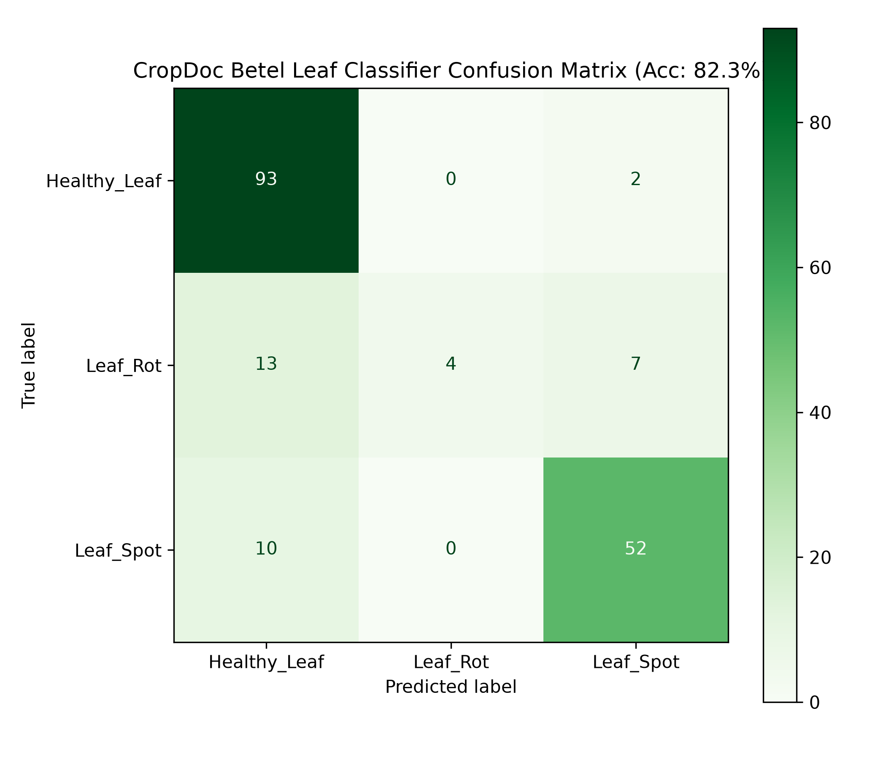

# CropDoc: Betel Leaf Disease Detection System

An end-to-end, lightweight, on-device disease diagnosis, severity estimation, explainability, and actionable treatment recommendation software suite for betel leaf (*Piper betle*) pathology.

## Problem Statement

Betel leaf is a high-value cash crop of immense economic and cultural importance across South Asia. However, betel vine cultivation (*bareja*) is highly susceptible to destructive fungal and bacterial diseases, primarily **Leaf Rot** (*Phytophthora parasitica* / *Sclerotium rolfsii*) and **Leaf Spot** (*Xanthomonas campestris* / *Colletotrichum piperis*). Farmers frequently lack access to timely, expert pathological diagnosis in remote rural fields, leading to misdiagnosis, indiscriminate chemical pesticide application, crop loss, and soil degradation. CropDoc provides an accessible, mobile-friendly AI diagnostic system that delivers instant disease classification, surface severity percentage scoring, visual Grad-CAM heatmap explainability, and actionable agronomic treatment guidelines directly to farmers and extension workers.

## Novelty Statement

> Across all 10 papers reviewed, classification-only work never adds severity scoring. Severity-focused work uses heavier models and covers only one disease each. Lightweight/mobile-deployment work never adds severity or explainability. No paper combines disease classification, severity scoring, explainability, and treatment recommendation in a single lightweight, deployable pipeline — this is the specific gap CropDoc addresses.

## Project Structure

```
CropDoc/
├── README.md                      # Project overview, setup, usage, results & references
├── requirements.txt                # Exact pinned dependencies
├── .gitignore                      # Git exclusion rules
├── LICENSE                         # MIT License
├── config.py                       # Centralized configuration & hyperparameters
├── data/
│   ├── raw/                        # Extracted dataset (Mendeley Data vpzkntzjty)
│   └── sample_images/              # Example sample images per class for demo/testing
├── src/
│   ├── __init__.py                 # Package initialization
│   ├── data_loader.py              # Dataset loading, train/val/test splits, augmentation
│   ├── model.py                    # MobileNetV2 transfer learning architecture
│   ├── train.py                    # Standalone training script (python -m src.train)
│   ├── evaluate.py                 # Evaluation metrics & artifact generator
│   ├── severity.py                 # Color-thresholding HSV severity estimator
│   ├── explainability.py           # Grad-CAM activation heatmap overlay module
│   ├── treatment.py                # Decoupled treatment lookup engine
│   ├── treatment_rules.json        # Agronomic chemical & organic treatment database
│   ├── validate_image.py           # Image upload quality & corruption validator
│   └── pipeline.py                 # Unified diagnose_leaf() diagnostic pipeline
├── notebooks/
│   └── exploration.ipynb           # Exploratory notebook with visible output cells
├── app/
│   └── streamlit_app.py            # Interactive Streamlit web application
├── models/
│   └── betel_disease_model.keras   # Saved trained MobileNetV2 model checkpoint
├── results/
│   ├── accuracy_loss_curve.png     # Evaluation metrics plot
│   ├── confusion_matrix.png        # Test set confusion matrix visualization
│   ├── classification_report.txt   # Detailed classification report text
│   └── sample_predictions/         # Evidence diagnostic reports & Grad-CAM overlays
├── docs/
│   ├── architecture.md             # Stage-by-stage pipeline architecture design
│   └── literature_review.md        # Comprehensive 10-paper literature review
└── tests/
    └── test_pipeline.py            # Unit test suite (pytest)
```

## Setup Instructions

### 1. Virtual Environment Setup
Clone the repository and create a Python 3.11 virtual environment:

```bash
git clone https://github.com/your-username/CropDoc.git
cd CropDoc

# Create virtual environment
python -m venv venv

# Activate virtual environment
# Windows (PowerShell):
.\venv\Scripts\Activate.ps1
# Linux / macOS:
source venv/bin/activate
```

### 2. Install Dependencies
Install all pinned dependencies:

```bash
pip install -r requirements.txt
```

### 3. Dataset Placement
Download the **Comprehensive Betel Leaf Disease Dataset** from Mendeley Data:
- **Mendeley Data DOI**: [10.17632/vpzkntzjty.1](https://data.mendeley.com/datasets/vpzkntzjty/1)

Extract the zip file into `data/raw/`. The directory structure will look as follows:
`data/raw/Betel Leaf Dataset/Original_Dataset/[Healthy_Leaf, Leaf_Rot, Leaf_Spot]`

---

## How to Run

### 1. Model Training
Run standalone model training on the dataset:

```bash
python -m src.train
```

*Saves the best model checkpoint to `models/betel_disease_model.keras`.*

### 2. Model Evaluation
Compute test metrics, confusion matrix, and report artifacts:

```bash
python -m src.evaluate
```

*Outputs `results/confusion_matrix.png`, `results/accuracy_loss_curve.png`, and `results/classification_report.txt`.*

### 3. Interactive Streamlit Web App
Launch the interactive web demo interface:

```bash
streamlit run app/streamlit_app.py
```

### 4. Unit Testing
Run the automated test suite:

```bash
python -m pytest tests/test_pipeline.py
```

---

## Results & Empirical Evaluation

The fine-tuned MobileNetV2 classifier was evaluated on an independent test split of the betel leaf pathology dataset.

- **Test Accuracy**: **82.32%**
- **Test Precision**: **85.63%**
- **Test Recall**: **79.01%**

### Confusion Matrix



### Classification Summary Report

```text
              precision    recall  f1-score   support

Healthy_Leaf     0.8017    0.9789    0.8815        95
    Leaf_Rot     1.0000    0.1667    0.2857        24
   Leaf_Spot     0.8525    0.8387    0.8455        62

    accuracy                         0.8232       181
   macro avg     0.8847    0.6614    0.6709       181
weighted avg     0.8454    0.8232    0.7902       181
```

---

## Credits & References

### Dataset Reference
- **Hridoy, R. H., Habib, M. T., Mahmud, I., Haque, A., & Mamun, M. A. A.** (2025). *Comprehensive Betel Leaf Disease Dataset for Advanced Pathology Research*. Mendeley Data, V1. DOI: [10.17632/vpzkntzjty.1](https://data.mendeley.com/datasets/vpzkntzjty/1).

### Literature Review References (docs/literature_review.md)
1. **Multi-Dataset Plant Leaf Disease Detection** (2025). EfficientNet-B0, EfficientNet-B3, ResNet50, DenseNet201 fine-tuning on PlantDoc.
2. **Salka et al.** (2025). *CNN Review for Leaf Disease Detection*. Artificial Intelligence Review, Springer.
3. **Chowdhury et al.** (2023). *Plant Leaf Disease Detection: Bangladesh's Perspective*. Custom CNN vs. classical ML baseline.
4. **Mustofa et al.** (2023). *A Comprehensive Review on Leaf Disease Detection Using Deep Learning*. PRISMA ViT vs CNN survey.
5. **Yao et al.** (Univ. of Tasmania). *Machine Learning for Leaf Disease Classification: Data, Techniques and Applications*.
6. **PD36-C** (2024). *A Compact 1.251 Million Parameter CNN Model for Plant Disease Detection*.
7. **Mishra et al.** (2025). *Deep Learning-Based Disease Detection in Potato and Mango Leaves*. Scientific Reports, 15, 4521.
8. **Foysal et al.** (2024). *Multi-Class Plant Leaf Disease Detection with Mobile App Integration*. TensorFlow Lite Android deployment.
9. **Zhao et al.** (2025). *Plant Disease Segmentation Networks for Fast Automatic Severity Estimation*. MDPI Agriculture, 15(2), 188.
10. **Automatic Image-Based Plant Disease Severity Estimation Using Deep Learning** (2024). 4-stage severity classifier benchmark.
