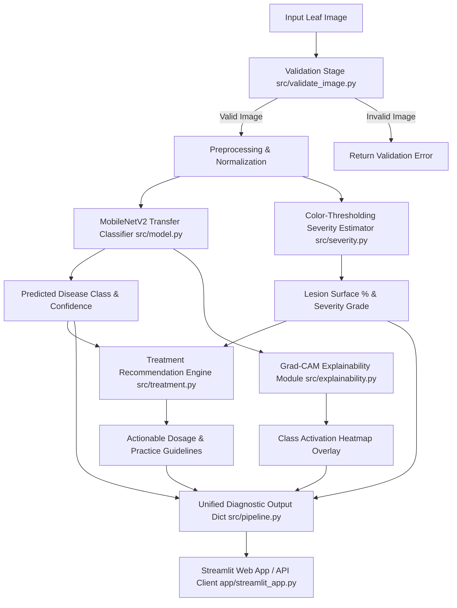

# CropDoc System Architecture

CropDoc is an end-to-end, lightweight, on-device disease diagnosis, severity estimation, explainability, and treatment system designed specifically for betel leaf (*Piper betle*) pathology.

## Stage-by-Stage Architecture Pipeline

### Stage 1: Validation (`src/validate_image.py`)
- Verifies input file type (`.jpg`, `.jpeg`, `.png`).
- Checks for file corruption and unreadable byte streams.
- Rejects completely blank, solid color, or extreme brightness images (over-exposure/under-exposure check).

### Stage 2: Classification (`src/model.py`, `src/train.py`)
- **Base Backbone**: Pretrained MobileNetV2 architecture (trained on ImageNet). MobileNetV2 uses depthwise separable convolutions and inverted residual blocks, keeping parameter count under ~2.3M.
- **Top Layers**: GlobalAveragePooling2D → Dropout (0.3) → Dense Softmax output layer (3 classes: Healthy, Leaf Rot, Leaf Spot).
- **Optimization**: Adam optimizer with categorical cross-entropy loss, learning rate scheduler, and early stopping.

### Stage 3: Severity Scoring (`src/severity.py`)
- Converts RGB leaf image to HSV color space.
- Segments healthy leaf area (green hues) and diseased lesion area (brown/black/yellow/rot hues).
- Calculates Infection Percentage:
  $$\text{Severity Ratio (\%)} = \frac{\text{Lesion Pixel Count}}{\text{Total Leaf Surface Area Count}} \times 100$$
- Maps percentage to four standardized agronomic grades:
  - **Healthy**: $< 2\%$
  - **Mild**: $2\% - 15\%$
  - **Moderate**: $15\% - 40\%$
  - **Severe**: $> 40\%$

### Stage 4: Explainability / Grad-CAM (`src/explainability.py`)
- Extracts feature maps from MobileNetV2's final convolutional layer (`Conv_1`).
- Computes gradients of the top predicted class score with respect to feature maps.
- Weights activation maps by average gradients to project class relevance back onto the original image as a JET heatmap overlay.

### Stage 5: Treatment Recommendation Engine (`src/treatment.py`)
- Queries `src/treatment_rules.json` using `(Disease, Severity Grade)` tuple.
- Returns structured advice containing:
  - Active chemical / organic fungicides and dosages
  - Cultural field management practices
  - Preventive measures for surrounding crop canopy

### Stage 6: Unified Pipeline & UI (`src/pipeline.py`, `app/streamlit_app.py`)
- `diagnose_leaf()` orchestrates Stages 1 to 5 into a single call.
- Renders an intuitive web application interface for farmers and field workers.
